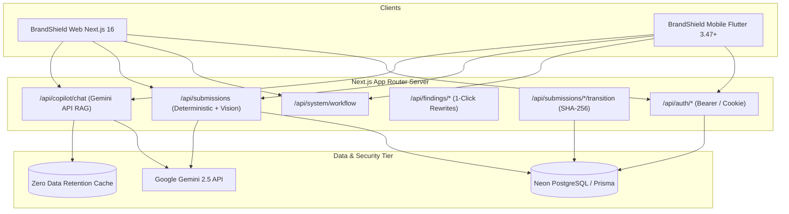

# BrandShield AI Mobile — Architecture & System Design

This document details the architectural patterns, state management, networking protocols, and shared business logic connecting the BrandShield AI Flutter app with the Next.js web application.

---

## 🏛️ System Architecture

BrandShield AI follows a **Unified Backend Multi-Client Architecture**:
- **Single Source of Truth**: Neon PostgreSQL database managed via Prisma ORM on Next.js.
- **Shared API Surface**: RESTful endpoints served by Next.js App Router (`/api/*`).
- **Unified Identity**: Firebase Authentication with RS256 token verification on the server and fallback session tokens.
- **AI Engine**: Google Gemini API running server-side (`/api/copilot/chat`) with live Retrieval-Augmented Generation (RAG) and zero token leakage to clients.



---

## 📦 Directory Structure & Layer Responsibilities

```
mobile/lib/
├── app/
│   ├── brandshield_app.dart     # MultiProvider root & bottom tab shell
│   └── constants.dart           # BrandColors, ApiConstants & routes
├── core/
│   ├── network/api_client.dart  # HTTP client, bearer injection, error mapping
│   ├── storage/token_storage.dart # SharedPreferences token & user persistence
│   ├── theme/brand_theme.dart   # Material 3 light theme & typography
│   └── utils/contrast_calculator.dart # WCAG 2.1 relative luminance math
├── features/
│   ├── analytics/               # Department compliance & SHA-256 ledger
│   ├── approvals/               # Sign-off queue & cryptographic hashes
│   ├── auth/                    # Login, persona switcher & auto-login
│   ├── copilot/                 # Gemini chat, citations & prompt chips
│   ├── dashboard/               # 7-stage workflow journey & KPIs
│   ├── findings/                # Policy violations & 1-click AI rewrites
│   ├── integrations/            # GitLab CI/CD, Figma, Google Docs
│   ├── knowledge_base/          # Ground-truth docs & design tokens
│   ├── onboarding/              # 5-step role-based guided tour dialog
│   ├── scanner/                 # Text draft composer & banner image picker
│   └── settings/                # Role switcher, i18n & API endpoint URL
├── localization/
│   └── app_localizations.dart   # Full English and Hindi dictionary
├── models/
│   ├── approval.dart            # SHA-256 approval record
│   ├── chat_message.dart        # ChatMessage & Citation models
│   ├── finding.dart             # Severity, policy citations, suggested fixes
│   ├── kpi.dart                 # Governance health & average score
│   ├── submission.dart          # Submission draft & findings collection
│   ├── user.dart                # User & UserRole (4 stakeholder personas)
│   └── workflow_stage.dart      # 7-stage live workflow model
└── services/
    ├── approvals_service.dart   # Sign-offs & change requests
    ├── auth_service.dart        # Auto-login, role switching & session
    ├── copilot_service.dart     # Streaming/RAG Gemini interaction
    ├── findings_service.dart    # Rewrite application & overrides
    ├── scanner_service.dart     # Multi-modal audit submissions
    └── workflow_service.dart    # KPI calculation & 7-stage polling
```

---

## 🔒 Authentication & Token Bridge

The Next.js backend supports dual-mode authentication via `getSessionUser()` in `src/lib/brandshield/server/auth.ts`:
1. **Web**: Encrypted HTTP-only cookies (`brandshield_session`).
2. **Mobile**: `Authorization: Bearer <token>` HTTP header.

Every login, auto-login, role-switch, and registration route returns:
```json
{
  "id": "cmw...",
  "email": "marcus@nimbus.demo",
  "name": "Marcus Reed",
  "role": "reviewer",
  "token": "brandshield_session_token_value",
  "zeroDataRetention": true
}
```

The Flutter `ApiClient` intercepts every outgoing HTTP request, reads the token from `SharedPreferences`, and attaches `Authorization: Bearer <token>`.

